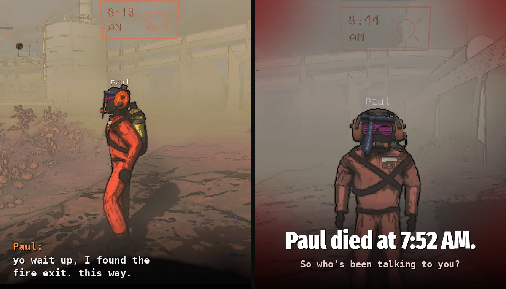

# PlayerMimics

Masked become impostor crewmates. A Masked looks, moves and (with consent) sounds like one of your friends. A local AI
plays it: it walks with the group, talks on voice chat, carries loot, and waits for the moment nobody's looking.

Replaces Mirage, MirageRevive, LethalMimics and MaskFixes. Don't install it together with them.

## Features

- **A perfect disguise:** the copied player's suit, cosmetics, name tag and animations. No mask, no glowing eyes, no
  radar spin, and it can't be scanned.
- **Moves like them:** player speed and stamina, crouching, jumping and looking around, and it picks up the copied
  player's own habits during the round.
- **Sounds like them:** with consent, it talks in their cloned voice and style, answers when you talk to it, and
  makes small talk.
- **Acts like a crewmate:** grabs scrap, hands things over, takes loot to the ship, uses doors, runs from monsters and
  steps around mines and webs (mostly).
- **Hunts like a Masked:** it notices when you get suspicious, comes for you once you've figured it out, and if you
  wander off alone with one, you might not come back.
- **Revives:** players who die with nobody watching can get back up as a Masked copying them.

Everyone in the lobby needs the mod. Only the host needs the AI server. Without the server, Masked still disguise
themselves and follow simple rules; they just don't talk.

## Host only: the AI server

The voices and the brain run on the host's PC in a separate program, the
[PlayerMimics AI server](https://github.com/DasPauluteli/PlayerMimics/tree/main/server), for Windows and Linux.
Everything stays local: no accounts, no cloud. The default setup needs a GPU with about 20 GB of VRAM; smaller AI
models work on smaller GPUs.

1. Download the [server folder](https://github.com/DasPauluteli/PlayerMimics/tree/main/server) and run `setup.bat`
   (Windows) or `./setup.sh` (Linux) once.
2. Before hosting, start `start.bat` or `./start.sh` and leave it open while you play.

## Optional mods

PlayerMimics uses these when they're installed:

- [BetterEmotes](https://thunderstore.io/c/lethal-company/p/KlutzyBubbles/BetterEmotes/): Masked use its emotes and
  signs. Hit one with a stop sign and it runs.
- [MoreCompany](https://thunderstore.io/c/lethal-company/p/notnotnotswipez/MoreCompany/): Masked wear cosmetics.
- [Coroner](https://thunderstore.io/c/lethal-company/p/EliteMasterEric/Coroner/): the end-of-round report names who
  the killer was pretending to be.
- [LethalConfig](https://thunderstore.io/c/lethal-company/p/AinaVT/LethalConfig/): change the settings in game.

## Voice and consent

The first time you join a PlayerMimics lobby, a popup asks whether your voice may be used for an AI copy in this game.
Only if you allow it does your voice chat go to the host. Nothing is saved to disk unless the host turns that on, and
then the popup says so. You can change your answer in the config (`Voice > VoiceCloningConsent`).

## Settings worth knowing

All host only, in `BepInEx/config/com.pauluteli.PlayerMimics.cfg` (or LethalConfig):

- `Aggression`: how likely a Masked is to go for someone who's alone with it (0 to 1).
- `MinSecondsBeforeAttack`: how long it blends in before attacking in front of others.
- `Revive > ChancePercent`: how often dead players come back as a Masked.
- `SpawnMaskedKey`, `ShowBrainOverlay`, `NoAttack`: for trying it out alone.
